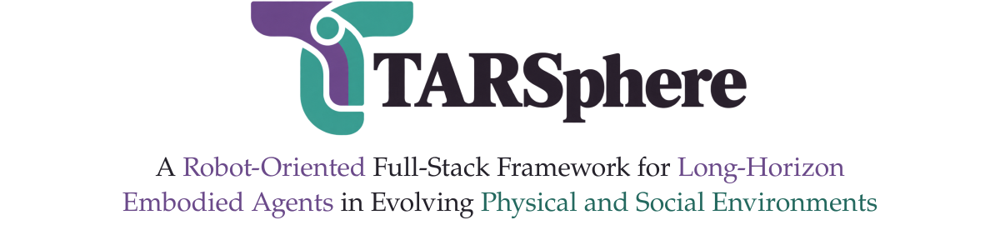

<div align="center">

<picture>
  <source media="(prefers-color-scheme: dark)" srcset="docs/assets/tarsphere-header-dark.svg">
  
</picture>

<p>
<a href="https://github.com/xuyicheng-zju">Yicheng&nbsp;Xu</a><sup>1</sup> &nbsp;·&nbsp; <a href="https://github.com/ZhikaiXu24">Zhikai&nbsp;Xu</a><sup>1</sup> &nbsp;·&nbsp; <a href="https://openreview.net/profile?id=~Ziyuan_Chen9">Ziyuan&nbsp;Chen</a><sup>2</sup> &nbsp;·&nbsp; <a href="https://openreview.net/profile?id=~Yuhang_Dong4">Yuhang&nbsp;Dong</a><sup>1</sup> &nbsp;·&nbsp; <a href="https://openreview.net/profile?id=~Tao_Zhang100">Tao&nbsp;Zhang</a><sup>1</sup> &nbsp;·&nbsp; <a href="https://github.com/xzc-zju">Zhucun&nbsp;Xue</a><sup>1</sup> &nbsp;·&nbsp; <a href="https://openreview.net/profile?id=~Yong_Liu11">Yong&nbsp;Liu</a><sup>1</sup> &nbsp;·&nbsp; <a href="https://github.com/zhangzjn">Jiangning&nbsp;Zhang</a><sup>1</sup>
</p>

<sup>1</sup> Zhejiang University &nbsp;&nbsp; <sup>2</sup> Fudan University

<a href="https://github.com/xuyicheng-zju/TARSphere"></a>
<a href="https://xuyicheng-zju.github.io/TARSphere/"></a>

<a href="#quick-start"> Quick Start</a>&nbsp;&nbsp; · &nbsp;&nbsp;<a href="#documentation"> Documentation</a>&nbsp;&nbsp; · &nbsp;&nbsp;<a href="README.zh-CN.md">中文</a>

<br>

<a href="docs/assets/teaser.png"></a>

<sub>Socially grounded interaction · Policy-driven grasping · Evolving tasks · Physical execution</sub>


<a href="LICENSE"></a>

</div>

---

<h2 id="overview"> Meet TARSphere</h2>

Connect multimodal reasoning to physical robot execution, embodied human interaction, and changing task requirements.

| Component | Capabilities |
| --- | --- |
| **TARSphere-Infra** | Robot execution, embodied NPCs, dialogue, and event-driven task transitions. |
| **TARSphere-Harness** | Observations, hierarchical memory, executable skills, and feedback for a frozen MLLM. |
| **TARSphere-Bench** | Task authoring, paired condition examples, and causal evaluation for navigation and delivery. |

<h2 id="todo"> TODO</h2>

<p>
 Infra Harness<br>
 Data Curation<br>
 Benchmark Evaluation<br>
 Real-Robot
</p>

<h2 id="quick-start"> Quick Start</h2>

**Single RTX 4090 · Ubuntu 22.04 / 24.04 · Isaac Sim 5.1 · Python 3.11**

The default deployment uses one GPU and one Isaac worker. Agent and support language models run through remote OpenAI-compatible APIs; perception, navigation, and grasp services run locally.

**1. Prepare.** Install Isaac Sim and the [assets and checkpoints](assets/README.md), then fill the host template with your paths and model endpoints. Follow the [installation guide](docs/INSTALLATION.md) for Conda, system dependencies, and resource layout.

```bash
cp scripts/host_env.example.sh host_env.sh
# Fill local paths and agent/support API credentials in host_env.sh.
```

**2. Install and launch.** The default input is [a navigation example](examples/episodes/navigation.yaml).

```bash
scripts/setup.sh
scripts/evaluate.sh --plan
scripts/evaluate.sh
```

**3. Manage the run or supply your own tasks.**

```bash
scripts/evaluate.sh --status
scripts/evaluate.sh --stop
scripts/evaluate.sh --episodes /path/to/episodes
```

`--episodes` accepts YAML, a directory, or a JSON path index. `--plan` previews the launch configuration. Runtime files go to `~/.local/share/tarsphere/runs`; use `--output-dir` to choose another directory. Public execution uses the default mechanisms; ordinary history, action, camera, and mapping parameters remain configurable.

<h2 id="documentation"> Documentation</h2>

| Guide | Start here for |
| --- | --- |
|  [Installation](docs/INSTALLATION.md) | Environment setup, single-GPU deployment, and troubleshooting. |
|  [Assets & checkpoints](assets/README.md) | Upstream downloads and the required directory layout. |
|  [Evaluation](docs/EVALUATION.md) | Task inputs, execution, and scoring saved trajectories. |
|  [Task authoring](docs/BENCHMARK_AUTHORING.md) | Episode schemas, conditions, and physical validation. |
|  [Teleoperation](docs/TELEOPERATION.md) | Interactive robot and animated NPC control. |

<h2 id="tasks"> Tasks & Conditions</h2>

**Navigate-and-report** and **fetch-and-deliver** share a five-stage causal evaluation. The [source examples](episodes/README.md) cover six task conditions:

| | | |
| --- | --- | --- |
| **Base**<br>Default task | **PR** · Perceptual robustness<br>Changes in sensing | **DA** · Disruption adaptation<br>Changes in execution availability |
| **TU** · Task update<br>Revised requirements | **HC** · Human coordination<br>Onsite collaboration | **IU** · Intent understanding<br>Clarification and contextual intent |

Evaluation includes Success, Progress, path efficiency, safety, and inference cost. Provide your task collection through `--episodes`.

<h2 id="repository"> Repository</h2>

```text
tarsphere/
  simulator/       Simulation core and extensions
  embodiment/      Robot profiles and controllers
  infra/           Physical execution and simulator integration
  harness/         Model interface, memory, and skills
  bench/           Episode schemas and task authoring
  evaluation/      Task-state evaluation and scoring
scripts/           Setup, execution, scoring, and rendering
episodes/          Task and condition examples
examples/          Small runnable examples
third_party/       Bundled upstream source and notices
```

Assets and checkpoints are installed separately. Keep credentials and generated runtime files outside the distributed source.

<h2 id="acknowledgments"> Acknowledgments</h2>

We thank the authors and maintainers of the works that support TARSphere:

- [GRScenes](https://huggingface.co/datasets/InternRobotics/GRScenes) for indoor scene assets.
- [OpenFrontier](https://github.com/cvg/OpenFrontier) for the visual frontier exploration approach, [FrontierNet](https://github.com/cvg/FrontierNet) for frontier prediction, and [NavDP / X-NavDP](https://github.com/InternRobotics/NavDP) and [InternNav](https://github.com/InternRobotics/InternNav) for navigation components.
- [SAM3](https://github.com/facebookresearch/sam3), [GraspGenX](https://github.com/NVlabs/GraspGenX), and [cuRobo](https://github.com/NVlabs/curobo) for perception, grasp generation, and motion planning.
- [NVIDIA Isaac Sim](https://docs.isaacsim.omniverse.nvidia.com/5.1.0/index.html) for the underlying simulation engine.

Component-specific upstream links, citations, licenses, and local adaptations are documented in [third_party](third_party/README.md). Scene packages, robot assets, Isaac Sim, native character animations, and model weights retain their own terms and are installed separately; see [assets](assets/README.md).

<h2 id="license"> License</h2>

Copyright 2026 TARSphere contributors. Original project code and documentation are licensed under [Apache-2.0](LICENSE).
