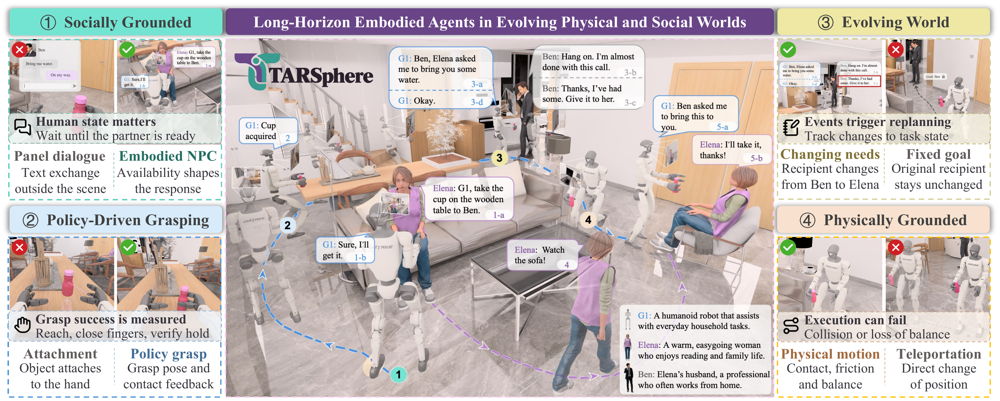

<div align="center">

<picture>
  <source media="(prefers-color-scheme: dark)" srcset="docs/assets/tarsphere-logo-dark.svg">
  
</picture>

<h3>面向动态物理与社会环境中长时程具身智能体的全栈框架</h3>

<p>
<strong><a href="https://github.com/xuyicheng-zju">Yicheng&nbsp;Xu</a></strong><sup>1</sup> &nbsp;·&nbsp; <strong><a href="https://github.com/ZhikaiXu24">Zhikai&nbsp;Xu</a></strong><sup>1</sup> &nbsp;·&nbsp; <strong><a href="https://openreview.net/profile?id=~Ziyuan_Chen9">Ziyuan&nbsp;Chen</a></strong><sup>2</sup> &nbsp;·&nbsp; <strong><a href="https://openreview.net/profile?id=~Yuhang_Dong4">Yuhang&nbsp;Dong</a></strong><sup>1</sup> &nbsp;·&nbsp; <strong><a href="https://openreview.net/profile?id=~Tao_Zhang100">Tao&nbsp;Zhang</a></strong><sup>1</sup> &nbsp;·&nbsp; <strong><a href="https://github.com/xzc-zju">Zhucun&nbsp;Xue</a></strong><sup>1</sup> &nbsp;·&nbsp; <strong><a href="https://openreview.net/profile?id=~Yong_Liu11">Yong&nbsp;Liu</a></strong><sup>1</sup> &nbsp;·&nbsp; <strong><a href="https://github.com/zhangzjn">Jiangning&nbsp;Zhang</a></strong><sup>1</sup>
</p>

<sup>1</sup> Zhejiang University &nbsp;&nbsp; <sup>2</sup> Fudan University

<p>
<a href="https://arxiv.org/abs/2610.30043"></a>
<a href="https://github.com/xuyicheng-zju/TARSphere"></a>
<a href="https://xuyicheng-zju.github.io/TARSphere/"></a>
</p>

<p>
<a href="#overview"><b>概览</b></a> &nbsp;·&nbsp; <a href="#todo"><b>TODO</b></a> &nbsp;·&nbsp; <a href="#quick-start"><b>安装</b></a> &nbsp;·&nbsp; <a href="README.md#documentation"><b>文档</b></a> &nbsp;·&nbsp; <a href="#tasks"><b>任务</b></a> &nbsp;·&nbsp; <a href="#acknowledgments"><b>致谢</b></a> &nbsp;·&nbsp; <a href="README.md"><b>English</b></a>
</p>

<a href="docs/assets/teaser.png"></a>

<sub>具身社会交互 · 策略驱动抓取 · 动态任务 · 物理执行</sub>


<a href="LICENSE"></a>

</div>

---

<h2 id="overview">🧭 项目特点</h2>

| 组件 | 能力 |
| --- | --- |
| **TARSphere-Infra** | 机器人物理执行、具身 NPC 与对话、事件驱动的任务状态转换。 |
| **TARSphere-Harness** | 为冻结的多模态模型提供观测、分层记忆、多层级技能与执行反馈。 |
| **TARSphere-Bench** | 导航与递送任务的 episode schema、任务编写、条件样例和因果评测。 |

<h2 id="todo">✅ TODO</h2>

<p>
 Infra Harness<br>
 Data Curation<br>
 Benchmark Evaluation<br>
 Real-Robot
</p>

<h2 id="quick-start">🚀 快速开始</h2>

**单张 RTX 4090 · Ubuntu 22.04 / 24.04 · Isaac Sim 5.1 · Python 3.11**

使用 Ubuntu 22.04/24.04 x86-64、Conda、Python 3.11 和 Isaac Sim **5.1 standalone**。默认入口使用一张 GPU、一个 Isaac worker，agent 与辅助语言模型使用远程 OpenAI 兼容视觉 API；SAM3、GraspGenX、X-NavDP 在本卡运行。24 GiB 的显存能否容纳具体场景及服务，需要实际检查。

使用完整源码仓库或解压后的源码归档；wheel 只提供 Python 库，不包含部署脚本、任务样例及第三方服务源码。

先按[资产说明](assets/README.md)安装场景、机器人、动画和检查点，再复制并填写路径、agent model ID 和 agent/support API：

```bash
cp scripts/host_env.example.sh host_env.sh
# 编辑 host_env.sh，填写路径和远程视觉模型服务。
scripts/setup.sh
scripts/evaluate.sh --plan
scripts/evaluate.sh
scripts/evaluate.sh --status
```

`--plan` 用于预览启动配置。默认运行 `examples/episodes/navigation.yaml`；自己的任务可通过 `--episodes` 传入 YAML 文件、目录或 JSON 路径索引：

```bash
scripts/evaluate.sh --plan --episodes /path/to/episodes
scripts/evaluate.sh --episodes /path/to/episodes
```

运行文件默认保存在 `~/.local/share/tarsphere/runs`，可用 `--output-dir` 指定其他目录。`scripts/evaluate.sh --stop` 停止受管运行。开源入口只保留默认机制，历史长度、动作长度、映射频率等普通参数仍可配置。详细步骤见[安装](docs/INSTALLATION.md)和[评测](docs/EVALUATION.md)。

机器人与 NPC 的交互控制见独立的[遥操文档](docs/TELEOPERATION.zh-CN.md)。

<h2 id="tasks">🎯 任务与条件</h2>

两类任务沿用正文名称：**navigate-and-report** 与 **fetch-and-deliver**。每个场景各有 Base、perceptual robustness（PR）、disruption adaptation（DA）、task update（TU）、human coordination（HC）、intent understanding（IU）六种条件。

评测包括 Success、Progress、路径效率、安全性和推理成本。本仓库提供源码和两类任务、六种条件的样例，自定义任务集通过 `--episodes` 接入。样例与协议见 [episodes](episodes/README.md) 和[评测文档](docs/EVALUATION.md)。

<h2 id="acknowledgments">🙏 致谢</h2>

感谢以下工作的作者与维护者：

- [GRScenes](https://huggingface.co/datasets/InternRobotics/GRScenes)：室内场景资产。
- [OpenFrontier](https://github.com/cvg/OpenFrontier)、[FrontierNet](https://github.com/cvg/FrontierNet)、[NavDP / X-NavDP](https://github.com/InternRobotics/NavDP) 与 [InternNav](https://github.com/InternRobotics/InternNav)：导航方法与组件。
- [SAM3](https://github.com/facebookresearch/sam3)、[GraspGenX](https://github.com/NVlabs/GraspGenX) 与 [cuRobo](https://github.com/NVlabs/curobo)：感知、抓取生成与运动规划。
- [NVIDIA Isaac Sim](https://docs.isaacsim.omniverse.nvidia.com/5.1.0/index.html)：底层仿真引擎。

各部件的来源与许可证见 [third_party](third_party/README.md)。

<h2 id="license">📄 许可证</h2>

原创代码与文档采用 [Apache-2.0](LICENSE)。
